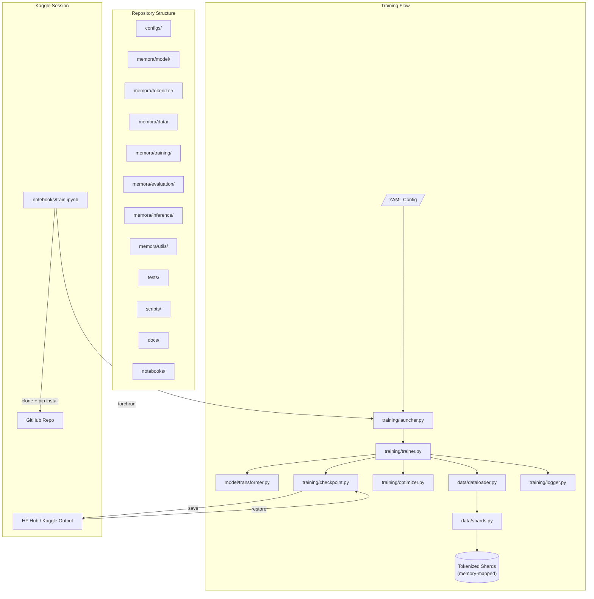
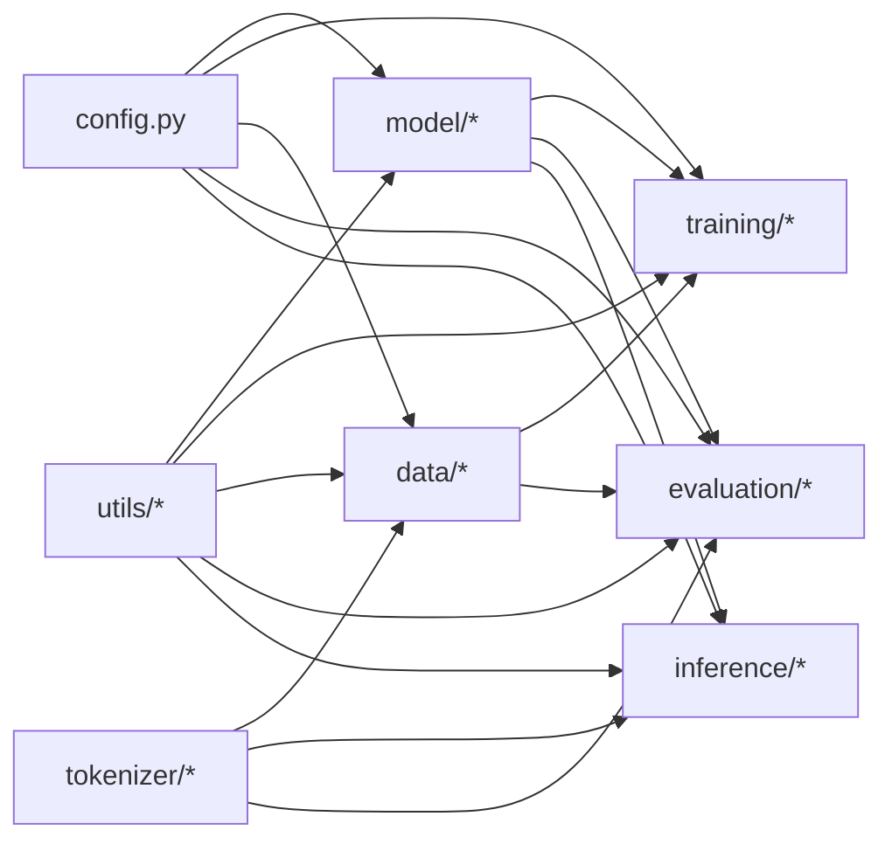
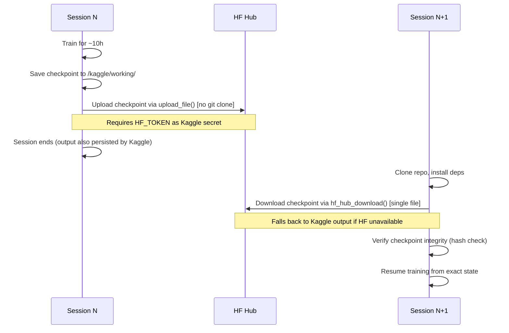

# Memora v1 — Architecture Design

## 1. Architecture Overview



## 2. Model Architecture

### 2.1 Design: GPT-style Decoder-Only Transformer

| Parameter | Value | Justification |
|-----------|-------|---------------|
| Architecture | Decoder-only Transformer | Standard for autoregressive LM; proven, well-understood |
| Layers (`n_layers`) | 24 | Depth-width balance for ~300M; matches GPT-2 Medium depth |
| Hidden dim (`d_model`) | 960 | Gives ~297M params with 4× FFN ratio; divisible by 15 heads |
| Attention heads (`n_heads`) | 15 | 960/15 = 64 dim per head; 64 is the standard efficient head dim |
| Head dim (`d_head`) | 64 | Standard; efficient for GPU Tensor Cores (multiples of 8/16) |
| FFN dim (`d_ff`) | 3840 | 4 × d_model; standard ratio, proven effective |
| FFN activation | GELU | Standard in GPT-2/GPT-3 family; well-tested, simple |
| Normalization | Pre-LayerNorm (with affine weight + bias) | More stable training than Post-LN; standard modern practice |
| Position encoding | RoPE (Rotary Position Embeddings) | No learnable params; strong length generalization; standard |
| Vocab size | 32,768 (2^15) | Power of 2 for GPU efficiency; adequate for English |
| Context length | 1,024 tokens | Adequate for pretraining; RoPE allows future extension |
| Embedding tying | Input/output embeddings tied | Reduces params by ~31.5M; standard practice at this scale |
| Bias terms | **No bias** in attention/FFN; **bias** in LayerNorm only | Modern convention (LLaMA, GPT-NeoX); simplifies, slight speedup |
| Dropout | 0.0 | Standard for pretraining at scale; regularization from data volume |
| Weight init | GPT-2 style: N(0, 0.02) for most; residual-scaled 1/√(2·n_layers) for output projections | Stable training; prevents signal explosion in deep residual networks |

### 2.2 Alternatives Considered and Rejected

| Alternative | Verdict | Reasoning |
|-------------|---------|-----------|
| SwiGLU/Gated FFN | **Rejected (for now)** | Better quality per param, but adds complexity (3 matrices per FFN block), and at this budget would require reducing layers or d_ff to hit 300M. For a first project prioritizing simplicity and debuggability, standard GELU is safer. Can revisit if Owner prefers. |
| RMSNorm instead of LayerNorm | **Rejected** | Marginal speed gain; LayerNorm is more battle-tested in PyTorch; RMSNorm requires custom implementation or extra dependency |
| GQA/MQA (grouped/multi-query attention) | **Rejected** | Benefits appear at inference scale with KV-cache; at 300M pretraining scale with 15 heads, standard MHA is simpler and equally fast |
| ALiBi instead of RoPE | **Rejected** | RoPE is now more standard, better length generalization data, widely used in modern open models |
| d_model=1024, fewer layers | **Rejected** | 24L/1024d/4096ff = 335M (too large); reducing to 20-22 layers sacrifices depth for width, generally worse at this scale |
| d_model=768, more layers | **Rejected** | 32L/768d/3072ff = 252M (too small); would need ~40 layers to reach 300M, impractically deep for the width |
| Untied embeddings | **Rejected** | Adds ~31.5M params (328M total); those params are better spent on transformer layers |

### 2.3 Exact Parameter Count

**297,0M parameters (tied), 328.4M (untied)**

Detailed breakdown (tied, no bias in attn/FFN):

```
Token embedding:          32,768 × 960 =  31,457,280
Per transformer layer:
  Q projection:             960 × 960  =     921,600
  K projection:             960 × 960  =     921,600
  V projection:             960 × 960  =     921,600
  O projection:             960 × 960  =     921,600
  Attention subtotal:                  =   3,686,400
  FFN up:                   960 × 3840 =   3,686,400
  FFN down:                3840 × 960  =   3,686,400
  FFN subtotal:                        =   7,372,800
  LayerNorm 1 (weight+bias): 960 + 960 =       1,920
  LayerNorm 2 (weight+bias): 960 + 960 =       1,920
  Norm subtotal:                       =       3,840
  Layer total:                         =  11,063,040
All 24 layers:        24 × 11,063,040  = 265,512,960
Final LayerNorm (weight+bias):         =       1,920
LM head (tied to embedding):          =           0
RoPE (no learnable params):           =           0
─────────────────────────────────────────────────────
TOTAL:                                 = 296,972,160
```

**Note:** d_model=960 is not a power of 2, but it IS divisible by 64 (960 = 15 × 64), which is what matters for Tensor Core alignment on T4 (multiples of 8 for fp16). The head dimension of 64 is standard and efficient.

### 2.4 Tensor Shapes Through the Model

For batch size B, sequence length S=1024, d=960, H=15, d_h=64, V=32768, d_ff=3840:

```
Input token IDs:    (B, S)           → int64
Token embeddings:   (B, S, 960)      → fp16/fp32
                    ↓ (× 24 layers)
  Pre-attn LN:     (B, S, 960)      → fp16
  Q, K, V proj:    (B, S, 960) → (B, H, S, 64) each
  RoPE applied:    Q, K: (B, H, S, 64) (rotated)
  Attention:       (B, H, S, S)      → fp16  [causal mask applied]
  Attn output:     (B, H, S, 64) → (B, S, 960)
  O projection:    (B, S, 960)      → fp16
  Residual add:    (B, S, 960)      → fp16/fp32
  Pre-FFN LN:      (B, S, 960)      → fp16
  FFN up:          (B, S, 3840)     → fp16
  GELU:            (B, S, 3840)     → fp16
  FFN down:        (B, S, 960)      → fp16
  Residual add:    (B, S, 960)      → fp16/fp32
                    ↓
Final LN:          (B, S, 960)      → fp16
LM head:           (B, S, 32768)    → fp32 (for loss computation)
```

## 3. Tokenizer

### 3.1 Decision: Byte-level BPE via HuggingFace `tokenizers`

| Property | Value |
|----------|-------|
| Algorithm | Byte-level BPE (à la GPT-2) |
| Library | `tokenizers` (HuggingFace, Rust-backed) |
| Vocab size | 32,768 |
| Special tokens | `<\|pad\|>` (0), `<\|bos\|>` (1), `<\|eos\|>` (2), `<\|unk\|>` (3) |
| Pre-tokenization | Byte-level (no UNK possible; all bytes representable) |
| Normalization | NFC Unicode normalization |
| Training corpus | Sample from FineWeb-Edu (~5-10M documents) |
| Deterministic | Yes (fixed seed, fixed training data sample, versioned config) |

### 3.2 Alternatives Considered

| Alternative | Verdict | Reasoning |
|-------------|---------|-----------|
| SentencePiece BPE | Reasonable alternative | Mature, widely used; but `tokenizers` is faster, more configurable, and has better Python API. SentencePiece adds a C++ build dependency. |
| SentencePiece Unigram | Rejected | Slightly better compression in theory, but BPE is more standard for decoder-only LMs; most reference models use BPE |
| Tiktoken (OpenAI) | Rejected | Designed for encoding with a fixed vocab, not for training new tokenizers |
| Larger vocab (50k, 64k) | Rejected | At 300M params, embedding table cost matters. 32k→64k adds ~30M params to embeddings, ~10% of budget. 32k is sufficient for English. |
| Smaller vocab (16k) | Rejected | Longer sequences needed per document; slower training in tokens/sec-equivalent |

### 3.3 Versioning and Testing

- Tokenizer saved as `tokenizer.json` + `tokenizer_config.json` (HuggingFace format)
- SHA-256 hash of `tokenizer.json` recorded in training manifests
- Tests: encode/decode round-trip, special token IDs, deterministic output, vocab size, handling of edge cases (empty string, unicode, long sequences, whitespace-only)

## 4. Configuration System

### 4.1 Format: YAML with Pydantic Validation

All hyperparameters in `configs/300m.yaml`. Schema enforced by Pydantic model in `memora/config.py`.

### 4.2 Schema Overview

```yaml
# configs/300m.yaml — full schema with types, defaults, and justifications
# documented in IMPLEMENTATION_PLAN.md Section 4

model:
  d_model: 960           # int, hidden dimension
  n_layers: 24           # int, transformer layers
  n_heads: 15            # int, attention heads
  d_ff: 3840             # int, FFN intermediate dim
  vocab_size: 32768      # int, must match tokenizer
  max_seq_len: 1024      # int, context length
  dropout: 0.0           # float, 0 for pretraining
  use_bias: false        # bool, no bias in attn/FFN
  tie_embeddings: true   # bool, tie input/output embeddings
  norm_eps: 1.0e-5       # float, LayerNorm epsilon
  rope_base: 10000.0     # float, RoPE theta base
  init_std: 0.02         # float, weight init std dev

training:
  optimizer: "adamw"
  lr: 6.0e-4             # float, peak learning rate
  min_lr: 6.0e-5         # float, minimum LR (10% of peak)
  warmup_steps: 2000     # int, linear warmup steps
  max_tokens: 3_000_000_000  # int, total token budget
  weight_decay: 0.1      # float
  beta1: 0.9             # float
  beta2: 0.95            # float
  eps: 1.0e-8            # float
  grad_clip: 1.0         # float, max grad norm
  global_batch_tokens: 524_288  # int, ~512K tokens per step
  micro_batch_size: 16   # int, per-GPU micro batch
  seq_len: 1024          # int, must match model.max_seq_len
  precision: "fp16"      # str, fp16 with GradScaler for T4
  compile: false         # bool, torch.compile (measure before enabling)
  seed: 42               # int

checkpoint:
  dir: "checkpoints/"
  save_interval_steps: 500     # int
  keep_last_n: 3               # int, retention policy
  save_optimizer: true         # bool, full resumable
  lightweight_interval_steps: 100  # int, weights-only saves

data:
  dataset_name: "fineweb-edu-sample"
  tokenizer_path: "tokenizer/"
  shard_dir: "data/shards/"
  val_ratio: 0.005       # float, 0.5% for validation
  num_workers: 4         # int, dataloader workers
  seed: 42               # int, for deterministic split

evaluation:
  val_interval_steps: 500      # int
  val_tokens: 10_000_000       # int, ~10M tokens per val run
  sample_interval_steps: 1000  # int
  sample_prompts:
    - "The meaning of life is"
    - "In a groundbreaking discovery, scientists"
    - "Once upon a time in a land far away"
  sample_temperature: 0.8
  sample_top_k: 50
  sample_max_tokens: 128

logging:
  log_interval_steps: 10
  log_dir: "runs/"
  format: "jsonl"        # JSONL for machine-readable logs

distributed:
  backend: "nccl"
  strategy: "ddp"        # DistributedDataParallel
```

## 5. Repository Structure

```
memora-v1-300m-3b-toks/
├── configs/
│   ├── 300m.yaml              # Primary training config
│   └── tiny.yaml              # Tiny model for CPU tests
├── memora/
│   ├── __init__.py
│   ├── config.py              # Pydantic config schema + validation
│   ├── model/
│   │   ├── __init__.py
│   │   ├── transformer.py     # Full model: MemoraTransformer
│   │   ├── attention.py       # CausalSelfAttention with RoPE + SDPA
│   │   ├── feedforward.py     # FFN block (GELU)
│   │   ├── embedding.py       # Token + position (RoPE) embeddings
│   │   ├── layers.py          # TransformerBlock (attn + ffn + residual + norm)
│   │   └── param_counter.py   # Exact parameter counting CLI
│   ├── tokenizer/
│   │   ├── __init__.py
│   │   ├── trainer.py         # Tokenizer training script
│   │   └── wrapper.py         # Load/encode/decode interface
│   ├── data/
│   │   ├── __init__.py
│   │   ├── pipeline.py        # Download, filter, split, tokenize
│   │   ├── shards.py          # Memory-mapped shard reader/writer
│   │   ├── dataloader.py      # Deterministic, resumable DataLoader
│   │   └── manifest.py        # Dataset manifest (version, hashes, counts)
│   ├── training/
│   │   ├── __init__.py
│   │   ├── trainer.py         # Main training loop
│   │   ├── optimizer.py       # AdamW setup with param group logic
│   │   ├── scheduler.py       # LR schedule (warmup + cosine decay)
│   │   ├── checkpoint.py      # Save/load/validate/recover checkpoints
│   │   ├── logger.py          # JSONL/CSV logging
│   │   └── launcher.py        # CLI entry point (argparse, torchrun compat)
│   ├── evaluation/
│   │   ├── __init__.py
│   │   ├── perplexity.py      # Validation loss / perplexity / BPB
│   │   ├── benchmarks.py      # LM eval harness integration
│   │   ├── sampling.py        # Text generation with fixed prompts
│   │   └── analysis.py        # Loss-vs-position, loss curves
│   ├── inference/
│   │   ├── __init__.py
│   │   ├── generate.py        # Standalone generation pipeline
│   │   └── kv_cache.py        # KV-cache for efficient generation
│   └── utils/
│       ├── __init__.py
│       ├── reproducibility.py # Seed setting, env capture, determinism
│       ├── distributed.py     # DDP helpers, rank/world size, cleanup
│       ├── environment.py     # GPU detection, memory, CUDA version
│       └── io.py              # Atomic writes, hashing, file utils
├── tests/
│   ├── __init__.py
│   ├── test_config.py
│   ├── test_model.py
│   ├── test_attention.py
│   ├── test_tokenizer.py
│   ├── test_data_pipeline.py
│   ├── test_checkpoint.py
│   ├── test_training.py
│   ├── test_evaluation.py
│   ├── test_inference.py
│   └── test_param_counter.py
├── scripts/
│   ├── train_tokenizer.py     # CLI: train tokenizer
│   ├── prepare_data.py        # CLI: run data pipeline
│   ├── count_params.py        # CLI: count model parameters
│   ├── plot_curves.py         # CLI: plot training curves from logs
│   └── validate_checkpoint.py # CLI: validate checkpoint integrity
├── notebooks/
│   └── kaggle_train.py        # Generated Kaggle notebook source
├── docs/
│   ├── STATUS.md
│   ├── ARCHITECTURE.md        # This file
│   ├── IMPLEMENTATION_PLAN.md
│   ├── TRAINING_PLAN.md
│   ├── DATA_PLAN.md
│   ├── REPRODUCIBILITY.md
│   └── RISKS_AND_OPEN_QUESTIONS.md
├── tokenizer/                 # Trained tokenizer artifacts (gitignored binary, json committed)
├── .gitignore
├── LICENSE                    # Apache 2.0
├── README.md
├── CONTRIBUTING.md
├── CODE_OF_CONDUCT.md
├── pyproject.toml             # Package definition, deps, tool config
└── requirements.txt           # Pinned dependencies (generated from pyproject.toml)
```

### 5.1 Module Dependency Graph



Key principle: `model/` has NO dependency on `training/`, `data/`, or `evaluation/`. The model is independently loadable for inference.

## 6. Distributed Training Strategy

### 6.1 DDP (DistributedDataParallel)

- **Backend:** NCCL (CUDA), Gloo fallback (CPU)
- **Strategy:** Vanilla DDP, no FSDP (model fits in single GPU memory at 300M)
- **Data parallelism:** Each rank gets disjoint data shards; verified by test
- **Gradient sync:** AllReduce after backward, averaged across world size
- **Launch:** `torchrun --nproc_per_node=2` (Kaggle 2×T4)

### 6.2 Memory Budget (ESTIMATE, per T4, 16 GB VRAM)

```
Model params (fp16):           ~0.6 GB
Model params (fp32 master):    ~1.2 GB
Optimizer state (AdamW m+v):   ~2.4 GB
Gradients (fp16):              ~0.6 GB
Activations (varies with BS):  ~2-8 GB  (depending on micro_batch × seq_len)
CUDA overhead:                 ~0.5-1 GB
─────────────────────────────────────────
ESTIMATED TOTAL:               ~7-13 GB  (within 16 GB T4 VRAM)
```

Micro batch size of 16 × 1024 seq_len is the starting candidate. Must be verified by memory benchmark (Phase 6). Gradient accumulation bridges the gap to the target global batch size.

### 6.3 Mixed Precision

- **Autocast:** `torch.amp.autocast('cuda', dtype=torch.float16)`
- **GradScaler:** Required for fp16 on T4 (no native bf16)
- **Master weights:** fp32 (maintained by optimizer)
- **Loss computation:** fp32 (upcasted logits before cross-entropy)
- **Known risks:** Loss scale overflow at training start; NaN/Inf handling; GradScaler state must be checkpointed

## 7. Checkpoint System

### 7.1 Strategy: Tiered Checkpoints

| Type | Frequency | Contents | Size (est.) | Retention |
|------|-----------|----------|-------------|-----------|
| Full resumable | Every 500 steps | Model (fp32) + optimizer (fp32 m+v) + scheduler + scaler + RNG + metadata | **~3.6 GB** (1.19 GB model + 2.38 GB optimizer + ~30 MB other) | Last 2 |
| Lightweight | Every 100 steps | Model weights (fp32) + metadata only | **~1.2 GB** | Last 3 |
| Best validation | On new best val loss | Full resumable | **~3.6 GB** | Last 1 |
| **Total on disk** | | | **~14.4 GB** (2×3.6 + 3×1.2 + 1×3.6) | Within Kaggle 20 GB output limit |

### 7.2 Checkpoint Contents (Full Resumable)

```python
{
    "model_state_dict": ...,
    "optimizer_state_dict": ...,
    "scheduler_state_dict": ...,
    "grad_scaler_state_dict": ...,
    "global_step": int,
    "tokens_seen": int,
    "epoch": int,
    "data_shard_index": int,
    "data_position_in_shard": int,
    "best_val_loss": float,
    "config": dict,                    # Full config snapshot
    "dataset_manifest_hash": str,      # SHA-256 of manifest
    "tokenizer_hash": str,             # SHA-256 of tokenizer.json
    "git_commit": str,                 # Current commit hash
    "git_dirty": bool,                 # Whether working tree is dirty
    "rng_states": {
        "python": ...,
        "numpy": ...,
        "torch_cpu": ...,
        "torch_cuda": ...,            # Per-rank
    },
    "environment": {
        "pytorch_version": str,
        "cuda_version": str,
        "python_version": str,
        "hostname": str,
        "gpu_name": str,
        "world_size": int,
        "rank": int,
    },
    "session_id": str,
    "timestamp": str,
    "checkpoint_version": int,         # Schema version for forward compat
}
```

### 7.3 Atomic Write Protocol

1. Save to temp file: `checkpoint_step{N}.tmp`
2. `fsync` the file
3. Rename to `checkpoint_step{N}.pt`
4. Write metadata sidecar `checkpoint_step{N}.meta.json` (hash, size, step, timestamp)
5. Update `latest` symlink/pointer
6. Apply retention policy (delete old checkpoints)

### 7.4 Recovery

- On resume: load `latest` → verify hash → if corrupt, fall back to previous valid checkpoint
- Corruption detection: file size check + SHA-256 hash stored in sidecar
- Partial write detection: if `.tmp` file exists but no `.pt`, the save was interrupted → delete `.tmp`

### 7.5 Kaggle Persistence Round-Trip



**Upload/download time estimates:**
- **Optimistic** (~50 MB/s): 3.6 GB ≈ **72 seconds**
- **Pessimistic** (~10 MB/s): 3.6 GB ≈ **6 minutes**
- Both acceptable. Budget 2-6 min per checkpoint transfer.

**HF Hub repo history growth:** Uploading via `upload_file()` overwrites the same filename each time. HF Hub stores git LFS history, so repo size grows. Mitigation: downloading uses `hf_hub_download()` (single-file, no git clone) so history is irrelevant on the client side. If repo grows excessively, periodically create a fresh HF repo.

**Fallback if Kaggle internet unavailable:** Save checkpoint to `/kaggle/working/` and commit notebook output. Kaggle preserves output (up to 20 GB) as a "Version" which can be loaded as an input dataset in the next session. Retry HF upload 3× with exponential backoff before falling back.

## 8. Evaluation Strategy

### 8.1 Intrinsic Metrics

- **Validation loss** (cross-entropy, computed on held-out data)
- **Validation perplexity** (exp of validation loss; tokenizer-dependent)
- **Bits-per-byte (BPB)** (cross-tokenizer comparable; = loss × tokens / bytes × log2(e))

### 8.2 Benchmarks (at 300M scale, expectations are modest)

| Benchmark | Method | Few-shot | Why |
|-----------|--------|----------|-----|
| HellaSwag | lm-evaluation-harness | 0-shot | Commonsense reasoning; good signal at small scale |
| ARC-Easy | lm-evaluation-harness | 0-shot | Science knowledge, easier subset |
| PIQA | lm-evaluation-harness | 0-shot | Physical intuition |
| WinoGrande | lm-evaluation-harness | 0-shot | Coreference resolution |
| LAMBADA | lm-evaluation-harness | 0-shot | Word prediction in context |

**NOT running:** MMLU (too hard for 300M), HumanEval (code, not our domain), TruthfulQA (alignment-focused).

**Contamination concern:** FineWeb-Edu is web data; benchmark test sets may appear in training data. Will document this honestly. Cannot fully decontaminate without access to all benchmark prompts; will flag as a limitation.

### 8.3 Qualitative Evaluation

- Fixed prompt set with fixed seeds and decoding parameters
- Sampled at each milestone (100M, 300M, 1B, 2B, 3B tokens)
- Recorded in logs, not cherry-picked

### 8.4 Comparisons

- Compare to Pythia-160M, Pythia-410M (similar scale, public, well-documented)
- Compare ONLY where methodology is actually comparable (same benchmark, same few-shot setting, same harness version)
- Never claim superiority without rigorous evidence

## 9. Inference Pipeline

### 9.1 Standalone Design

The inference pipeline loads: trained weights + config + tokenizer. No dependency on training code.

```python
# Usage example
from memora.inference.generate import Generator

gen = Generator.from_checkpoint("checkpoints/best/", device="cpu")
output = gen.generate(
    prompt="The meaning of life is",
    temperature=0.8,
    top_k=50,
    top_p=0.9,
    max_new_tokens=128,
    seed=42,
)
print(output)
```

### 9.2 KV-Cache

Will implement KV-cache for autoregressive generation. Justification: without it, generation is O(n²) in sequence length which is impractically slow even for short outputs. Implementation is straightforward (cache K, V tensors per layer, concatenate on each step).

## 10. Compute Feasibility Analysis

> **STATUS: ESTIMATE.** Based on first-principles calculation, NOT measurement. Will be updated with measured throughput after Phase 6 benchmark.

### 10.1 Assumptions

- T4 peak fp16 Tensor Core: 65 TFLOPS — VERIFIED ([NVIDIA T4 specs](https://www.nvidia.com/en-us/data-center/tesla-t4/), checked 2026-10-01)
- FLOPs per token ≈ 6N ≈ 1.78 × 10⁹ (standard approximation, ignores attention quadratic term)
- Model FLOP Utilization (MFU): 10-30% range — UNKNOWN-NEEDS-MEASUREMENT
- DDP scaling efficiency on 2×T4 over PCIe: ~85% — ASSUMED, NEEDS-MEASUREMENT

### 10.2 Key Correction: 2×T4 Quota Rate

A Kaggle 2×T4 session consumes GPU quota at exactly 2× the wall-clock rate (1 wall-clock hour = 2 quota hours) based on community reports ([luminoai.in](https://luminoai.in), 2026-10-01). — ASSUMED (will be verified in Phase 6 by comparing Kaggle's quota meter before and after short 1×T4 and 2×T4 test sessions).

30h weekly quota → only 15 clock-hours of 2×T4 usage. Since DDP scaling is always < 100%, **1×T4 is always more quota-efficient**. Default: use 1×T4. 2×T4 only useful if wall-clock speed is more important than total quota consumed.

### 10.3 Throughput Estimates — 1×T4 (Recommended)

| Scenario | MFU | tok/s | 1B tokens | 3B tokens | Weeks (at ~25h eff/week) |
|----------|-----|-------|-----------|-----------|---------------------------|
| **Plausible Low** | **10%** | **3,611** | **76.9h** | **230.8h** | **1B: 3.1w · 3B: 9.2w** |
| **Plausible Base** | **15%** | **5,417** | **51.3h** | **153.8h** | **1B: 2.1w · 3B: 6.2w** |
| Conservative | 20% | 7,222 | 38.5h | 115.4h | 1B: 1.5w · 3B: 4.6w |
| Target | 25% | 9,028 | 30.8h | 92.3h | 1B: 1.2w · 3B: 3.7w |
| **Optimistic High** | **30%** | **10,833** | **25.6h** | **76.9h** | **1B: 1.0w · 3B: 3.1w** |

### 10.4 Feasibility Verdict (ESTIMATE)

| Target | MFU | Hours (1×T4) | Weeks | Verdict |
|--------|-----|-------------|-------|----------|
| 1B tokens | 30% (likely) | ~25.6h | ~1.0w | ✅ **Very feasible** |
| 1B tokens | 15% (pessimistic) | ~51.3h | ~2.1w | ✅ **Feasible** |
| 1B tokens | 10% (very pessimistic) | ~76.9h | ~3.1w | ⚠️ **Feasible but slow** |
| 3B tokens | 30% (likely) | ~76.9h | ~3.1w | ✅ **Feasible** |
| 3B tokens | 20% (worst) | ~115.4h | ~4.6w | ⚠️ **Tight** — needs 5 weeks |
| 3B tokens | 15% (pessimistic) | ~153.8h | ~6.2w | ⚠️ **Risky** — needs 6+ weeks |
| 3B tokens | 10% (very pessimistic) | ~230.8h | ~9.2w | ❌ **Likely infeasible** |

**Recommendation:** Default to 1×T4 (more quota-efficient). 1B tokens is safe in all scenarios. 3B tokens is feasible if MFU ≥ 20% (~3-5 weeks). Phase 6 benchmark determines the actual MFU.

### 10.5 Stop/Extend Decision Rules (Post-Benchmark)

See TRAINING_PLAN.md Section 3.5 for the full decision table. Summary:
- tok/s ≥ 9,000 → go to 3B
- tok/s 5,000-9,000 → go to 3B if Owner approves timeline, else target 1-2B
- tok/s 3,500-5,000 → target 1-2B, investigate bottleneck
- tok/s < 3,500 → stop, debug software issue before burning quota

### 10.6 Checkpoint Size vs. Kaggle Limits

- Full resumable checkpoint: **~3.6 GB** (model 1.19 GB + optimizer 2.38 GB + metadata ~30 MB)
- Lightweight checkpoint: **~1.2 GB** (model only)
- Kaggle output limit: 20 GB — VERIFIED ([kaggle.com/docs](https://kaggle.com/docs), checked 2026-10-01)
- Retention (2 full + 3 lightweight + 1 best): ~14.4 GB → fits in 20 GB ✅
- HF Hub upload: 3.6 GB at 10-50 MB/s ≈ 72 sec to 6 min → acceptable overhead
