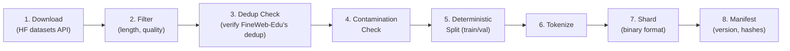

# Memora v1 — Data Plan

## 1. Dataset Selection

### 1.1 Primary Recommendation: FineWeb-Edu (sample-10BT)

| Property | Value | Status |
|----------|-------|--------|
| Name | FineWeb-Edu (sample-10BT) | VERIFIED ([HF dataset card](https://huggingface.co/datasets/HuggingFaceFW/fineweb-edu), 2026-10-01) |
| Source | HuggingFace: `HuggingFaceFW/fineweb-edu` (sample-10BT config) | VERIFIED ([HF dataset card](https://huggingface.co/datasets/HuggingFaceFW/fineweb-edu), 2026-10-01) |
| License | ODC-By 1.0 (Open Data Commons Attribution) | VERIFIED ([HF dataset card](https://huggingface.co/datasets/HuggingFaceFW/fineweb-edu), 2026-10-01) |
| Size | ~10B tokens (~26 GB Parquet, compressed) | VERIFIED ([HF dataset card](https://huggingface.co/datasets/HuggingFaceFW/fineweb-edu), 2026-10-01) |
| Language | English only | VERIFIED ([HF dataset card](https://huggingface.co/datasets/HuggingFaceFW/fineweb-edu), 2026-10-01) |
| Quality | Classifier-filtered for educational content | VERIFIED ([HF dataset card](https://huggingface.co/datasets/HuggingFaceFW/fineweb-edu), 2026-10-01) |
| Preprocessing | Already cleaned: URL/boilerplate removal, language filtering, near-dedup | VERIFIED ([HF dataset card](https://huggingface.co/datasets/HuggingFaceFW/fineweb-edu), 2026-10-01) |
| Format | Parquet with `text` column | VERIFIED ([HF dataset card](https://huggingface.co/datasets/HuggingFaceFW/fineweb-edu), 2026-10-01) |
| Redistribution | Allowed with attribution (ODC-By) but dataset card does not settle third-party copyright | ASSUMED |
| Public release compatible | ✅ Yes (but see publication strategy below) | ASSUMED |

**Why FineWeb-Edu:**
- Already extensively cleaned and deduplicated (saves massive preprocessing effort)
- Educational content filter improves quality per token (particularly beneficial when training on "only" 3B tokens — quality matters more than quantity when undertrained)
- 10BT sample is more than enough for our 3B token target
- Permissive license compatible with Apache-2.0 project
- Well-documented provenance and methodology
- Used as baseline in multiple open-source LLM projects

### 1.2 Publication Strategy

While the dataset card is ODC-By, this does not settle third-party copyright in the underlying web text. Therefore, we will separate what we publish:
- **Code and Tokenizer:** We will publish the training code and the trained tokenizer (along with its vocabulary and merges).
- **Tokenized Shards:** By default, we will **NOT** redistribute the binary tokenized data shards.
- **Reproducibility:** Instead, we will publish the build scripts and a manifest (e.g., exact Parquet file list, row ranges, and hash signatures) so that anyone can deterministically rebuild the exact training shards from the upstream dataset.

### 1.3 Alternatives Considered

| Dataset | License | Size | Verdict | Reasoning |
|---------|---------|------|---------|-----------|
| FineWeb (full) | ODC-By 1.0 | 15T tokens | **Too large** | We need 3B tokens; 10BT sample is sufficient. Full download would be ~50 TB. |
| The Pile | MIT components, mixed | ~800 GB | **Rejected** | Mixed licenses; some components restrict commercial use; older, less clean than FineWeb-Edu |
| RedPajama-Data-v2 | Mixed/CC-By | ~30T tokens | **Rejected** | Too large to download; less educational filtering; mixed license complexity |
| C4 | ODC-By 1.0 | ~350 GB | **Reasonable alternative** | Well-known, but lower quality than FineWeb-Edu; less preprocessing done |
| SlimPajama | Apache-2.0 | 627B tokens | **Reasonable alternative** | Good license, pre-deduplicated; but FineWeb-Edu has better quality filtering |
| Dolma v1.7 | ODC-By/AI2 ImpACT | ~3T tokens | **Reasonable alternative** | High quality but larger than needed; less educational focus |

### 1.4 Why Not Multiple Sources?

At 3B tokens (a small training run), mixing multiple corpora adds complexity (proportions, domain weighting, contamination tracking across sources) with limited benefit. A single, high-quality, well-understood source is simpler and more reproducible. If we had a 100B+ token budget, mixing would be justified.

## 2. Data Pipeline Design

### 2.1 Pipeline Stages



### 2.2 Stage Details

#### Stage 1: Download
- Use `datasets` library to stream FineWeb-Edu sample-10BT
- Stream-process (don't download entire dataset to disk at once)
- Kaggle has internet access during sessions → can stream
- Alternative: pre-process on a cloud instance and upload tokenized shards as a Kaggle Dataset

**Disk budget concern:** 10BT of Parquet is ~26 GB. We only need ~3-4B tokens worth of text. We'll take a deterministic subset.

#### Stage 2: Filter (Lightweight, on top of FineWeb-Edu's existing filtering)
- **Minimum document length:** ≥ 50 tokens (reject very short documents)
- **Maximum document length:** ≤ 100,000 tokens (reject anomalously long documents)
- **UTF-8 validity:** reject malformed text
- No additional quality filtering (FineWeb-Edu is already quality-filtered)

**Justification for minimal filtering:** FineWeb-Edu has already applied: language detection, quality classification, URL filtering, boilerplate removal, and near-deduplication. Adding more filtering risks removing good data with minimal quality gain.

#### Stage 3: Deduplication
- **Decision:** Trust FineWeb-Edu's existing near-deduplication
- Do NOT re-run MinHash/SimHash (computationally expensive, FineWeb-Edu already did it)
- Do run exact deduplication on document hashes (SHA-256 of normalized text) as a sanity check — cheap and catches any remaining exact duplicates

#### Stage 4: Contamination Check
- Compute document-level hashes for all benchmark evaluation sets (HellaSwag, ARC, PIQA, WinoGrande, LAMBADA)
- Check for exact string matches of benchmark prompts in training data
- Remove any contaminated documents
- **Limitation:** Cannot detect paraphrased contamination; will document this honestly

#### Stage 5: Deterministic Train/Val Split

**Method:** Document-level split by stable hash.

```python
def assign_split(document_text: str, val_ratio: float = 0.005) -> str:
    """Assign document to train or val split using stable hash."""
    doc_hash = hashlib.sha256(document_text.encode('utf-8')).hexdigest()
    # Use last 8 hex chars as a uniform random number
    hash_value = int(doc_hash[-8:], 16) / 0xFFFFFFFF
    return "val" if hash_value < val_ratio else "train"
```

**Properties:**
- **Deterministic:** Same document always assigned to same split, regardless of processing order
- **Immutable:** Adding/removing documents from the corpus doesn't change other documents' assignments
- **Reproducible:** Any implementation that computes the same hash produces the same split
- **Not based on position/RNG order:** Immune to data shuffling

**Val set size:** 0.5% of ~3.5B tokens = ~17.5M tokens (~17K documents). Sufficient for reliable loss estimates (standard error of loss estimate ≈ σ/√n is tiny at 17M tokens).

**Disjointness guarantee:** By construction (hash-based). Verified by test: assert train_hashes ∩ val_hashes = ∅.

#### Stage 6: Tokenize
- Use trained MemoraTokenizer
- Prepend `<|bos|>`, append `<|eos|>` to each document
- Concatenate tokenized documents into a stream
- No padding between documents (packed format)

#### Stage 7: Shard
- Write tokenized stream into fixed-size binary shards
- Format: flat array of `uint16` token IDs (2 bytes each, supports vocab up to 65535)
- Shard size: ~100 MB each (~50M tokens per shard)
- 3B tokens → ~60 shards total

**Shard file layout:**
```
shard_0000.bin: [token_0, token_1, ..., token_49999999]  # uint16, little-endian
shard_0001.bin: [token_50000000, ...]
...
```

Documents span shard boundaries (no padding at shard boundaries). This is fine because the DataLoader reads contiguous windows of `seq_len + 1` tokens.

**Memory mapping:** Shards are read via `numpy.memmap(path, dtype=np.uint16, mode='r')`. This gives random access without loading entire shards into RAM.

#### Stage 8: Manifest

```json
{
    "version": "1.0.0",
    "dataset_name": "fineweb-edu-sample-10bt-memora",
    "source": "HuggingFaceFW/fineweb-edu (sample-10BT)",
    "source_license": "ODC-By 1.0",
    "preprocessing": {
        "min_doc_tokens": 50,
        "max_doc_tokens": 100000,
        "dedup_method": "exact_hash (on top of FineWeb-Edu near-dedup)",
        "contamination_check": ["hellaswag", "arc", "piqa", "winogrande", "lambada"],
        "split_method": "sha256_hash_based",
        "val_ratio": 0.005
    },
    "tokenizer": {
        "type": "byte_level_bpe",
        "vocab_size": 32768,
        "hash": "<sha256 of tokenizer.json>"
    },
    "statistics": {
        "total_documents": null,
        "total_tokens": null,
        "train_tokens": null,
        "val_tokens": null,
        "train_documents": null,
        "val_documents": null,
        "num_shards_train": null,
        "num_shards_val": null,
        "bytes_per_token_avg": null
    },
    "shard_hashes": {
        "shard_0000.bin": "<sha256>",
        "...": "..."
    },
    "preprocessing_code_commit": "<git commit>",
    "created_at": "<timestamp>"
}
```

(Fields marked `null` are populated after processing.)

## 3. DataLoader Design

### 3.1 Resumable, Deterministic Loading

```python
class MemoraDataLoader:
    """Memory-mapped, sharded, deterministic, resumable data loader.
    
    Yields batches of (micro_batch_size, seq_len + 1) uint16 tensors.
    Caller splits into input[:, :-1] and target[:, 1:].
    
    Determinism: Given the same seed, rank, and world_size, the loader
    produces the same sequence of batches. This is achieved by:
    1. Shuffling shard order deterministically (seed-based)
    2. Within each shard, reading sequentially
    3. Each rank gets a disjoint subset of shards
    
    Resume: The state_dict captures (shard_index, position_within_shard).
    Loading this state restores the exact position.
    """
```

### 3.2 Data Flow

```
Shards on disk: [shard_0, shard_1, ..., shard_59]
                      ↓ (shuffle by seed)
Shuffled order:  [shard_37, shard_12, shard_55, ...]
                      ↓ (partition by rank)
Rank 0 shards:   [shard_37, shard_55, ...]  (even indices)
Rank 1 shards:   [shard_12, ...]             (odd indices)
                      ↓ (read sequentially within shard)
Contiguous window: [tok_i, tok_i+1, ..., tok_i+seq_len]
                      ↓ (batch micro_batch_size windows)
Batch:           (micro_batch_size, seq_len + 1) tensor
```

### 3.3 Epoch Handling

At ~3B tokens with ~50M tokens per shard and ~60 shards, a single pass through the data covers ~3B tokens. Since our token budget equals our data size, we train for approximately 1 epoch.

If we need more than 1 epoch:
- Re-shuffle shard order with a different seed (seed + epoch)
- Track epoch count in checkpoint state
- This gives different batch ordering each epoch

## 4. Data Storage Strategy

### 4.1 Where Data Lives

| Artifact | Location | Size (est.) | Committed to Git? |
|----------|----------|-------------|-------------------|
| Raw text (FineWeb-Edu) | Streamed, not stored | — | No |
| Trained tokenizer JSON | `tokenizer/tokenizer.json` | ~2 MB | Yes |
| Tokenized shards (train) | Kaggle Dataset | ~6 GB | No |
| Tokenized shards (val) | Kaggle Dataset | ~35 MB | No |
| Manifest | `data/manifest.json` | ~10 KB | Yes |
| Shard hashes | In manifest | — | Yes |

### 4.2 Kaggle Dataset Upload

Pre-tokenized shards uploaded as a Kaggle Dataset for fast access during training sessions:
- Upload once after data preparation
- Mount in notebook as an input dataset
- No re-downloading/re-tokenizing each session
- ~6 GB total → well within 200 GB Kaggle Dataset limit

### 4.3 Data Processing Location

**Option A (Recommended): Process on Kaggle CPU session**
- Kaggle CPU sessions don't consume GPU quota
- Adequate memory and disk for streaming processing
- Internet access for downloading from HuggingFace
- Output saved as Kaggle Dataset

**Option B: Process locally (Mac Air)**
- Download ~3-4B tokens of text → ~10-15 GB of Parquet → fits in 51 GB free disk
- Tokenize locally → ~6 GB of shards → fits
- Upload to Kaggle Dataset
- Slower but doesn't use any Kaggle time

**Recommendation:** Option A (Kaggle CPU) to avoid local disk pressure and leverage better network.

## 5. Tokenizer Training Data

The tokenizer is trained on a representative sample of the training data, NOT on the full dataset.

| Property | Value |
|----------|-------|
| Training sample size | 5-10 million documents (sampled deterministically from FineWeb-Edu) |
| Sampling method | First N documents from a deterministic shuffle |
| Seed | Same as data seed (42) |
| Expected training time | ~10-30 minutes on CPU |

The tokenizer is trained ONCE and versioned. It is NOT retrained when data processing is re-run.
