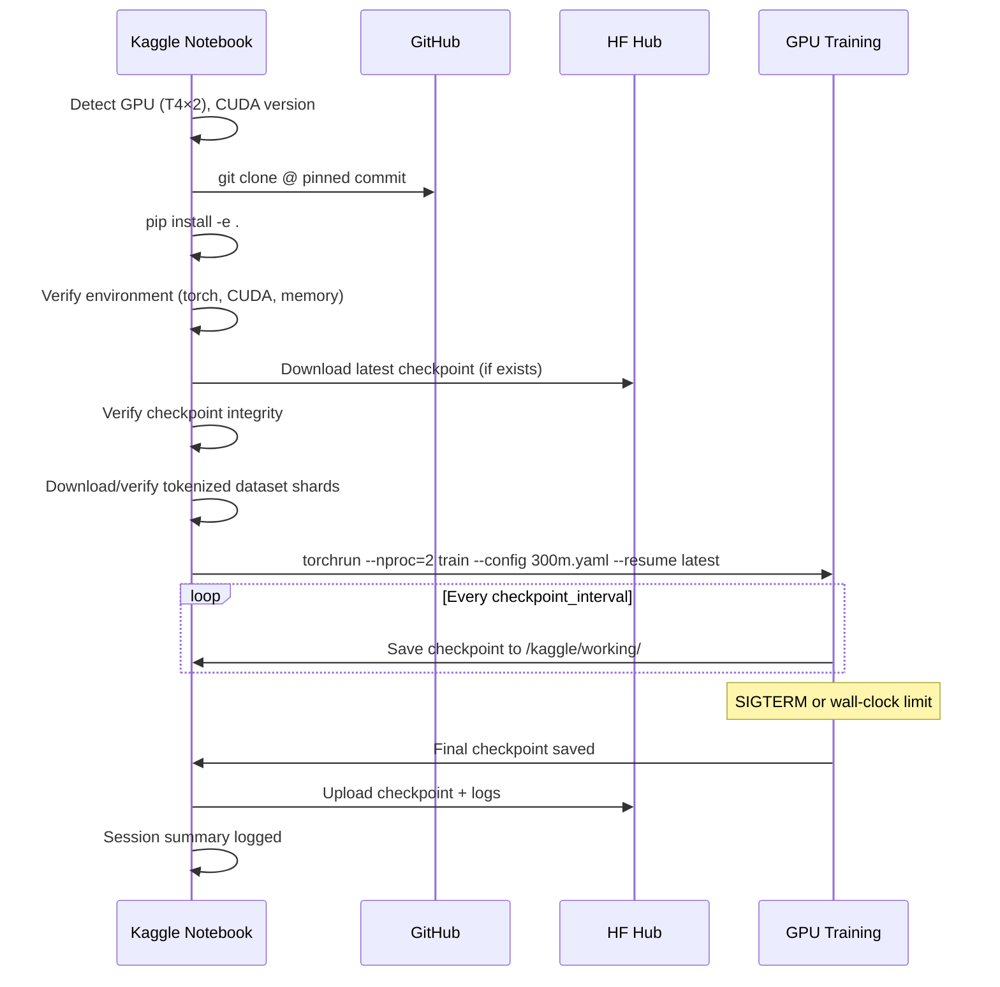

# Memora v1 — Implementation Plan

## 1. Implementation Order

Each subsystem has acceptance criteria that must pass before moving to the next.

### Stage 1: Repository Foundation
**Estimated time: 1-2 hours**

1. Create `pyproject.toml` with package definition, dependencies, and tool configs
2. Create `requirements.txt` (pinned, generated from pyproject.toml)
3. Set up linting/formatting: `ruff` (linter + formatter), `mypy` (type checking)
4. Create `CONTRIBUTING.md`, `CODE_OF_CONDUCT.md`
5. Create `.github/` issue templates (optional, low priority)

**Dependencies:**
```toml
[project]
name = "memora"
version = "0.1.0"
requires-python = ">=3.11.11, <3.15"  # Kaggle runs 3.11.11; local Mac has 3.14; PyTorch 2.10+ provides 3.14 wheels

dependencies = [
    "torch>=2.2.0",           # Core framework
    "pyyaml>=6.0",            # Config loading
    "pydantic>=2.0",          # Config validation
    "tokenizers>=0.19",       # HuggingFace tokenizers (Rust-backed)
    "numpy>=1.26",            # Array ops
    "tqdm>=4.66",             # Progress bars
    "huggingface-hub>=0.20",  # Model/checkpoint upload/download
]

[project.optional-dependencies]
dev = [
    "pytest>=8.0",
    "ruff>=0.3",
    "mypy>=1.8",
    "matplotlib>=3.8",        # Plotting only
]
eval = [
    "lm-eval>=0.4",          # lm-evaluation-harness
]
```

**Justification for each dependency:**
- `torch`: Core framework, non-negotiable
- `pyyaml`: YAML config parsing; lightweight, standard
- `pydantic`: Config schema validation; catches misconfiguration early; widely used
- `tokenizers`: Rust-backed, fast, well-maintained; needed for tokenizer training AND encoding
- `numpy`: Required by torch anyway; used for memory-mapped arrays
- `tqdm`: Progress bars; tiny, no alternatives needed
- `huggingface-hub`: Checkpoint upload/download to HF Hub; lightweight, well-maintained
- `lm-eval`: Only for evaluation, optional; maintained harness with standard benchmarks

**Acceptance criteria:**
- [x] `pip install -e .` succeeds in venv
- [x] `ruff check memora/` passes (no files yet, but tooling works)
- [x] `mypy memora/` passes
- [x] `pytest tests/` runs (no tests yet, but infrastructure works)

> **KAGGLE TORCH CONSTRAINT (binding):** On Kaggle, the training notebook MUST NOT reinstall or upgrade `torch`. The Kaggle GPU image ships a preinstalled, CUDA-matched `torch` (currently 2.x with CUDA 12). Reinstalling via pip would install a CPU-only or mismatched wheel, silently breaking CUDA. The notebook must import the preinstalled `torch` as-is and install only the remaining packages (`pip install -e . --no-deps` then install non-torch deps individually, or `pip install pyyaml pydantic tokenizers ...` without touching torch). Document the Kaggle torch version in the session log at startup.

### Stage 2: Configuration System
**Estimated time: 2-3 hours**

1. Implement `memora/config.py` — Pydantic models for all config sections
2. Create `configs/300m.yaml` — primary config
3. Create `configs/tiny.yaml` — tiny model for CPU testing (4 layers, d=128, 2 heads)
4. Config validation: type checking, value ranges, cross-field constraints (e.g., d_model % n_heads == 0)

**Interfaces:**
```python
# memora/config.py

class ModelConfig(BaseModel):
    d_model: int = 960
    n_layers: int = 24
    n_heads: int = 15
    d_ff: int = 3840
    vocab_size: int = 32768
    max_seq_len: int = 1024
    dropout: float = 0.0
    use_bias: bool = False
    tie_embeddings: bool = True
    norm_eps: float = 1e-5
    rope_base: float = 10000.0
    init_std: float = 0.02

    @model_validator(mode='after')
    def validate_dimensions(self) -> 'ModelConfig':
        assert self.d_model % self.n_heads == 0, "d_model must be divisible by n_heads"
        # ... more validations

class TrainingConfig(BaseModel):
    ...

class CheckpointConfig(BaseModel):
    ...

class DataConfig(BaseModel):
    ...

class EvalConfig(BaseModel):
    ...

class LoggingConfig(BaseModel):
    ...

class DistributedConfig(BaseModel):
    ...

class MemoraConfig(BaseModel):
    """Top-level config combining all sections."""
    model: ModelConfig
    training: TrainingConfig
    checkpoint: CheckpointConfig
    data: DataConfig
    evaluation: EvalConfig
    logging: LoggingConfig
    distributed: DistributedConfig

    @classmethod
    def from_yaml(cls, path: str) -> 'MemoraConfig':
        """Load and validate config from YAML file."""
        ...
```

**Acceptance criteria:**
- [ ] `MemoraConfig.from_yaml("configs/300m.yaml")` loads without error
- [ ] Invalid configs (wrong types, out-of-range values, d_model not divisible by n_heads) raise clear errors
- [ ] `configs/tiny.yaml` loads and describes a valid tiny model
- [ ] Unit tests in `tests/test_config.py` pass

### Stage 3: Tokenizer
**Estimated time: 3-4 hours**

1. Implement `memora/tokenizer/trainer.py` — train BPE tokenizer on text data
2. Implement `memora/tokenizer/wrapper.py` — load/encode/decode with consistent interface
3. Create `scripts/train_tokenizer.py` — CLI entry point
4. Train tokenizer on a sample (or use pre-existing if justified)
5. Save artifacts to `tokenizer/`

**Interfaces:**
```python
# memora/tokenizer/wrapper.py

class MemoraTokenizer:
    def __init__(self, tokenizer_path: str): ...
    def encode(self, text: str, add_special_tokens: bool = True) -> list[int]: ...
    def decode(self, token_ids: list[int], skip_special_tokens: bool = True) -> str: ...
    @property
    def vocab_size(self) -> int: ...
    @property
    def pad_id(self) -> int: ...
    @property
    def bos_id(self) -> int: ...
    @property
    def eos_id(self) -> int: ...
    def hash(self) -> str:
        """SHA-256 of tokenizer.json for versioning."""
        ...
```

**Acceptance criteria:**
- [ ] Tokenizer trains successfully on sample text
- [ ] `vocab_size == 32768`
- [ ] Encode/decode round-trip: `decode(encode(text)) == text` for normal text
- [ ] Special tokens have correct IDs (0, 1, 2, 3)
- [ ] No UNK tokens produced for any valid UTF-8 input (byte-level BPE guarantee)
- [ ] Deterministic: same input → same output across runs
- [ ] Hash is stable and reproducible
- [ ] Tests in `tests/test_tokenizer.py` pass

### Stage 4: Data Pipeline
**Estimated time: 6-8 hours**

1. Implement `memora/data/pipeline.py` — download/filter/split/tokenize
2. Implement `memora/data/shards.py` — write/read memory-mapped binary shards
3. Implement `memora/data/dataloader.py` — deterministic, resumable DataLoader
4. Implement `memora/data/manifest.py` — version/hash tracking
5. Create `scripts/prepare_data.py` — CLI entry point

**Shard format:**
```
File: shard_NNNN.bin
Layout: flat array of uint16 token IDs (2 bytes each)
        Documents separated by EOS token
        Packed contiguously, no padding between documents

Shard size: ~100MB each (configurable)
Memory mapping: numpy.memmap with dtype=np.uint16
```

**DataLoader contract:**
```python
# memora/data/dataloader.py

class MemoraDataLoader:
    def __init__(
        self,
        shard_dir: str,
        seq_len: int,
        micro_batch_size: int,
        seed: int,
        rank: int = 0,
        world_size: int = 1,
    ): ...

    def state_dict(self) -> dict:
        """Return current position for checkpointing."""
        ...

    def load_state_dict(self, state: dict) -> None:
        """Restore exact position for resuming."""
        ...

    def __iter__(self) -> Iterator[torch.Tensor]:
        """Yield (micro_batch_size, seq_len+1) tensors of token IDs.
        input = batch[:, :-1], target = batch[:, 1:]
        """
        ...
```

**Acceptance criteria:**
- [ ] Pipeline processes small sample end-to-end (download → tokenize → shard)
- [ ] Shards are memory-mappable and readable
- [ ] DataLoader produces correct batch shapes
- [ ] DataLoader is deterministic given seed
- [ ] DataLoader resumes from saved state correctly
- [ ] Train/val split is deterministic (by document hash)
- [ ] Train and val sets are provably disjoint (tested by assertion on document hashes)
- [ ] DDP: ranks get disjoint data (tested)
- [ ] Manifest records all required metadata
- [ ] Tests in `tests/test_data_pipeline.py` pass

### Stage 5: Model
**Estimated time: 4-6 hours**

1. Implement `memora/model/embedding.py` — token embeddings
2. Implement `memora/model/attention.py` — causal self-attention with RoPE + SDPA
3. Implement `memora/model/feedforward.py` — GELU FFN
4. Implement `memora/model/layers.py` — TransformerBlock
5. Implement `memora/model/transformer.py` — full MemoraTransformer
6. Implement `memora/model/param_counter.py` — parameter counting utility
7. Create `scripts/count_params.py` — CLI

**Interfaces:**
```python
# memora/model/transformer.py

class MemoraTransformer(nn.Module):
    def __init__(self, config: ModelConfig): ...
    def forward(
        self,
        input_ids: torch.Tensor,    # (B, S)
        targets: torch.Tensor | None = None,  # (B, S)
    ) -> tuple[torch.Tensor, torch.Tensor | None]:
        """Returns (logits, loss). Loss is None if targets is None."""
        ...

    @classmethod
    def from_config(cls, config: ModelConfig) -> 'MemoraTransformer':
        """Create model with proper initialization."""
        ...

    def count_parameters(self, trainable_only: bool = True) -> int:
        """Exact parameter count."""
        ...
```

**Acceptance criteria:**
- [ ] Model instantiates from config without error
- [ ] Forward pass produces correct output shapes: logits (B, S, V)
- [ ] Backward pass runs without error
- [ ] Parameter count matches planned 296,972,160 exactly
- [ ] Causal masking works (future tokens don't attend to past)
- [ ] RoPE embeddings are correct (test against reference implementation)
- [ ] Weight initialization is correct (verified statistically)
- [ ] Model works on CPU, MPS, and CUDA
- [ ] Tests in `tests/test_model.py`, `tests/test_attention.py`, `tests/test_param_counter.py` pass

### Stage 6: Model Tests (Thorough)
**Estimated time: 2-3 hours**

Extended tests beyond basic shape tests:
1. Tiny overfit test (must drive loss near zero on minuscule dataset)
2. Gradient flow test (all parameters receive gradients)
3. Numerical stability test (no NaN/Inf in forward/backward)
4. Determinism test (same seed → same output)
5. Mixed precision test (fp16 autocast forward/backward)

### Stage 7: Training Infrastructure
**Estimated time: 6-8 hours**

1. Implement `memora/training/optimizer.py` — AdamW with param groups
2. Implement `memora/training/scheduler.py` — warmup + cosine decay
3. Implement `memora/training/logger.py` — JSONL logging
4. Implement `memora/training/trainer.py` — main training loop
5. Implement `memora/training/launcher.py` — CLI with torchrun support
6. Create `scripts/plot_curves.py` — visualization

**Training loop contract:**
```python
# memora/training/trainer.py

class Trainer:
    def __init__(self, config: MemoraConfig): ...
    def train(self) -> None:
        """Main training loop. Handles:
        - Gradient accumulation
        - Mixed precision (autocast + GradScaler)
        - DDP synchronization
        - Periodic validation
        - Periodic checkpointing
        - Graceful shutdown (SIGTERM, wall-clock deadline)
        - Logging
        """
        ...
    def validate(self) -> dict[str, float]:
        """Run validation, return metrics."""
        ...
    def sample(self) -> list[str]:
        """Generate samples from fixed prompts."""
        ...
```

**Acceptance criteria:**
- [ ] Training runs on CPU with tiny config
- [ ] Loss decreases on tiny dataset
- [ ] Gradient accumulation produces correct effective batch size
- [ ] Mixed precision works (GradScaler updates correctly)
- [ ] SIGTERM triggers graceful checkpoint save
- [ ] Wall-clock deadline triggers graceful shutdown
- [ ] Logging produces valid JSONL with all required fields
- [ ] LR schedule is correct (verified by plotting)
- [ ] Tests in `tests/test_training.py` pass

### Stage 8: Checkpoint System
**Estimated time: 3-4 hours**

1. Implement `memora/training/checkpoint.py` — save/load/validate/recover
2. Create `scripts/validate_checkpoint.py` — CLI
3. Implement HF Hub upload/download helpers

**Acceptance criteria:**
- [ ] Checkpoint saves atomically (temp + rename)
- [ ] Checkpoint loads correctly, all state restored
- [ ] Resume-equivalence test passes (train N steps vs. train k + resume N-k)
- [ ] Corrupt checkpoint detected and falls back to previous
- [ ] Retention policy enforced
- [ ] Metadata sidecar written with hash and size
- [ ] HF Hub upload/download works
- [ ] Tests in `tests/test_checkpoint.py` pass

### Stage 9: Evaluation
**Estimated time: 3-4 hours**

1. Implement `memora/evaluation/perplexity.py` — val loss, perplexity, BPB
2. Implement `memora/evaluation/benchmarks.py` — lm-evaluation-harness wrapper
3. Implement `memora/evaluation/sampling.py` — text generation with fixed prompts
4. Implement `memora/evaluation/analysis.py` — loss curves, loss-vs-position

**Acceptance criteria:**
- [ ] Perplexity computed correctly (matches manual calculation)
- [ ] Bits-per-byte computed correctly
- [ ] Benchmark harness runs on tiny model (even if scores are random)
- [ ] Sampling produces deterministic output given seed
- [ ] Analysis plots generate correctly
- [ ] Tests in `tests/test_evaluation.py` pass

### Stage 10: Inference
**Estimated time: 2-3 hours**

1. Implement `memora/inference/kv_cache.py` — KV-cache for autoregressive generation
2. Implement `memora/inference/generate.py` — standalone generation pipeline

**Acceptance criteria:**
- [ ] Generation works independently of training code
- [ ] KV-cache produces same output as naive generation
- [ ] Temperature, top-k, top-p, seed all work correctly
- [ ] Runs on CPU and MPS
- [ ] Tests in `tests/test_inference.py` pass

### Stage 11: Kaggle Notebook
**Estimated time: 2-3 hours**

1. Create `notebooks/kaggle_train.py` — notebook source (converts to .ipynb)
2. Notebook is a thin control panel: clone, install, verify, launch, checkpoint

**Acceptance criteria:**
- [ ] Notebook contains no implementation logic
- [ ] Notebook handles secrets safely (Kaggle Secrets API)
- [ ] Notebook verifies GPU, memory, CUDA version before training
- [ ] Notebook launches training via `torchrun`
- [ ] Notebook manages checkpoint upload to HF Hub

### Stage 12: Documentation
**Estimated time: 2-3 hours**

1. Full README.md
2. Model card (docs/MODEL_CARD.md)
3. Reproduction guide (docs/REPRODUCTION.md)
4. CONTRIBUTING.md, CODE_OF_CONDUCT.md

### Stage 13: Integration Tests
**Estimated time: 2-3 hours**

End-to-end tests that exercise the full pipeline on tiny data:
1. Tokenizer → data pipeline → model → training → checkpoint → resume → evaluation → inference

### Stage 14: Final Reproducibility Audit
**Estimated time: 1-2 hours**

Verify all items in `docs/AUDIT.md`.

## 2. Staged Validation Ladder

Tests organized by stage, with clear pass/fail criteria. Stages 1-11 MUST pass locally before any GPU time.

| Stage | Test | Pass Criteria | Env |
|-------|------|---------------|-----|
| 1 | Static checks (ruff) | Zero errors | Local |
| 2 | Type checks (mypy) | Zero errors or documented exceptions | Local |
| 3 | Tokenizer round-trip | `decode(encode(text)) == text` for 100+ test strings | Local |
| 3 | Tokenizer special tokens | IDs match config | Local |
| 3 | Tokenizer determinism | Same hash across runs | Local |
| 4 | Data pipeline determinism | Same shard contents given same seed | Local |
| 4 | Split disjointness | Zero overlap between train/val doc hashes | Local |
| 4 | DataLoader resume | State after k+n steps == load state at k then n steps | Local |
| 4 | Manifest completeness | All required fields present and valid | Local |
| 5 | Model shape | Output logits shape matches (B, S, V) | Local CPU |
| 5 | Parameter count | Exactly 296,972,160 | Local CPU |
| 6 | Tiny forward/backward | No NaN/Inf, gradients on all params | Local CPU |
| 6 | Tiny overfit | Loss < 0.1 after N steps on 1-batch dataset | Local CPU |
| 7 | Checkpoint save/load | Loaded model produces identical output | Local CPU |
| 7 | Resume equivalence (CPU, fp32) | Losses match exactly | Local CPU |
| 8 | Resume equivalence (GPU, fp16) | Losses match within tolerance ε (document ε) | Kaggle |
| 9 | Mixed precision | GradScaler state updates, no overflow crashes | Local CPU (simulate) |
| 10 | Single-GPU smoke | Loss decreases for 100 steps, logs valid | Kaggle |
| 11 | Multi-GPU DDP smoke | Both ranks train, data disjoint, loss decreases | Kaggle |
| 11 | DDP resume | Resume from DDP checkpoint, training continues | Kaggle |
| 12 | Throughput benchmark | Measured tok/s reported | Kaggle |
| 13 | Memory benchmark | Peak VRAM reported, no OOM | Kaggle |
| 14 | Val loss sanity | Initial ≈ ln(32768) ≈ 10.4, decreasing | Kaggle |

## 3. Configuration Schema Reference

Full schema with every field, type, default, range, and justification:

### model.*

| Field | Type | Default | Range | Justification |
|-------|------|---------|-------|---------------|
| d_model | int | 960 | ≥64, % n_heads == 0 | Matches ~300M budget with 24L; 960 = 15 × 64 |
| n_layers | int | 24 | ≥1 | Standard depth for ~300M; GPT-2 Medium uses 24 |
| n_heads | int | 15 | ≥1, d_model % n_heads == 0 | 960/15 = 64 dim per head; 64 is efficient |
| d_ff | int | 3840 | ≥1 | 4 × d_model; standard ratio |
| vocab_size | int | 32768 | ≥256 | 2^15; adequate for English; GPU-efficient |
| max_seq_len | int | 1024 | ≥1 | Standard pretraining length; RoPE extensible |
| dropout | float | 0.0 | [0, 1) | Zero for pretraining; data regularizes |
| use_bias | bool | false | — | Modern convention; simplifies; slight speedup |
| tie_embeddings | bool | true | — | Saves ~31.5M params; standard at this scale |
| norm_eps | float | 1e-5 | >0 | Standard LayerNorm epsilon |
| rope_base | float | 10000.0 | >0 | Standard RoPE base frequency |
| init_std | float | 0.02 | >0 | GPT-2 convention; proven stable |

### training.*

| Field | Type | Default | Range | Justification |
|-------|------|---------|-------|---------------|
| optimizer | str | "adamw" | {"adamw"} | Standard for LLM pretraining |
| lr | float | 6e-4 | >0 | Scaled from GPT-3/Chinchilla for ~300M; within standard range |
| min_lr | float | 6e-5 | >0, ≤lr | 10% of peak; standard end-of-decay LR |
| warmup_tokens | int | 131,072,000 | ≥0 | ~131M tokens ≈ 250 steps at 524K batch. Token-based; schedule-agnostic. |
| lr_schedule | str | "cosine" | {"cosine", "wsd"} | Default cosine until Phase 6 determines committed horizon |
| wsd_decay_tokens | int | 100,000,000 | >0 | Only active when lr_schedule="wsd"; length of final decay window |
| max_tokens | int | 3,000,000,000 | >0 | Project target; ~10 tokens/param |
| weight_decay | float | 0.1 | ≥0 | Standard for transformers; excludes norms/biases |
| beta1 | float | 0.9 | (0, 1) | Standard Adam β1 |
| beta2 | float | 0.95 | (0, 1) | Slightly lower than default 0.999; better for LLM stability |
| eps | float | 1e-8 | >0 | Standard Adam ε |
| grad_clip | float | 1.0 | >0 | Standard max_norm clipping; prevents spikes |
| global_batch_tokens | int | 524,288 | >0, % (micro_batch_size × seq_len) == 0 | ~512K tokens; in Chinchilla range for ~300M. Phase 6 candidate: 262,144 |
| micro_batch_size | int | 16 | ≥1 | Per-GPU batch; constrained by T4 16GB VRAM |
| seq_len | int | 1024 | ≥1, == model.max_seq_len | Must match model |
| precision | str | "fp16" | {"fp16", "fp32"} | fp16 for T4; no bf16 support |
| compile | bool | false | — | Default off; measure before enabling |
| seed | int | 42 | any int | Reproducibility seed |

### checkpoint.*

| Field | Type | Default | Range | Justification |
|-------|------|---------|-------|---------------|
| dir | str | "checkpoints/" | valid path | Checkpoint output directory |
| save_interval_steps | int | 500 | ≥1 | ~8-10 minutes at expected throughput; reasonable frequency |
| keep_last_n | int | 3 | ≥1 | Retention; balances disk vs. safety |
| save_optimizer | bool | true | — | Required for exact resume |
| lightweight_interval_steps | int | 100 | ≥1 | Weights-only for quick recovery |

### data.*

| Field | Type | Default | Range | Justification |
|-------|------|---------|-------|---------------|
| dataset_name | str | "fineweb-edu-sample" | — | Identifier for the dataset |
| tokenizer_path | str | "tokenizer/" | valid path | Path to trained tokenizer |
| shard_dir | str | "data/shards/" | valid path | Tokenized binary shards |
| val_ratio | float | 0.005 | (0, 0.1) | 0.5% → ~15M val tokens; sufficient for loss estimate |
| num_workers | int | 4 | ≥0 | DataLoader parallelism |
| seed | int | 42 | any int | Deterministic split |

### evaluation.*

| Field | Type | Default | Range | Justification |
|-------|------|---------|-------|---------------|
| val_interval_steps | int | 500 | ≥1 | Same as checkpoint interval; natural pairing |
| val_tokens | int | 10,000,000 | ≥1 | ~10M tokens per val; ~1 minute compute |
| sample_interval_steps | int | 1000 | ≥1 | Text samples for qualitative tracking |
| sample_prompts | list[str] | (3 fixed) | ≥1 item | Fixed prompts for reproducible comparison |
| sample_temperature | float | 0.8 | >0 | Standard generation temperature |
| sample_top_k | int | 50 | ≥1 | Standard top-k |
| sample_max_tokens | int | 128 | ≥1 | Short samples for logging |

## 4. Training Flow Diagram

```mermaid
flowchart TD
    START["Start / Resume"] --> LOAD_CFG["Load Config (YAML)"]
    LOAD_CFG --> LOAD_TOK["Load Tokenizer"]
    LOAD_TOK --> LOAD_DATA["Initialize DataLoader"]
    LOAD_DATA --> INIT_MODEL["Initialize Model"]
    INIT_MODEL --> INIT_OPT["Initialize Optimizer + Scheduler + Scaler"]
    INIT_OPT --> CHECK_RESUME{"Resume from checkpoint?"}
    
    CHECK_RESUME -->|Yes| LOAD_CKPT["Load checkpoint state"]
    CHECK_RESUME -->|No| TRAIN_LOOP
    LOAD_CKPT --> TRAIN_LOOP
    
    TRAIN_LOOP["Training Loop"] --> STEP["Forward + Loss + Backward"]
    STEP --> ACCUM{"Accumulated enough\nmicro-steps?"}
    ACCUM -->|No| STEP
    ACCUM -->|Yes| CLIP["Clip Gradients"]
    CLIP --> OPT_STEP["Optimizer Step + Scaler Update + LR Step"]
    OPT_STEP --> LOG["Log Metrics"]
    LOG --> CHECK_VAL{"Val interval?"}
    CHECK_VAL -->|Yes| VALIDATE["Run Validation"]
    CHECK_VAL -->|No| CHECK_CKPT
    VALIDATE --> CHECK_CKPT{"Checkpoint interval?"}
    CHECK_CKPT -->|Yes| SAVE_CKPT["Save Checkpoint (atomic)"]
    CHECK_CKPT -->|No| CHECK_DONE
    SAVE_CKPT --> CHECK_DONE{"Token budget reached?\nOr wall-clock limit?\nOr SIGTERM?"}
    CHECK_DONE -->|No| STEP
    CHECK_DONE -->|Yes, graceful| FINAL_CKPT["Save Final Checkpoint"]
    FINAL_CKPT --> UPLOAD["Upload to HF Hub"]
    UPLOAD --> END["Session Complete"]
```



## 5. Kaggle Session Lifecycle



## 6. Selective Experiment List

| # | Experiment | Justification | Est. GPU-hours | Priority |
|---|-----------|---------------|----------------|----------|
| 1 | 1×T4 vs 2×T4 benchmark | Must decide GPU config before full run | 0.5h | **REQUIRED** |
| 2 | Micro-batch / memory sweep | Find max batch size for T4 16GB | 0.25h | **REQUIRED** |
| 3 | SDPA backend comparison | Evaluate mem-efficient vs math kernel on T4 | 0.25h | High |
| 4 | `torch.compile` effect | May or may not help on T4 sm_75 | 0.25h | Medium |
| 5 | Checkpoint overhead | Measure save/upload time | 0.1h | **REQUIRED** |
| 6 | Val-loss-vs-tokens curve | Primary training metric; automatic, no extra cost | 0h (included) | **REQUIRED** |

**Total experiment budget: ~1.4 GPU-hours** (before full training begins)

**Rejected experiments:**
- Seq-len 512 vs 1024: Not worth testing; 1024 is standard, and the memory budget allows it
- Tokenizer vocab size comparison: Would require retraining tokenizer and re-processing data; large time investment for marginal gain at 32k
- Different LR schedules: WSD vs cosine are close; stick with cosine decay (proven)
- Dropout values: 0 is standard for pretraining; testing non-zero wastes GPU time
